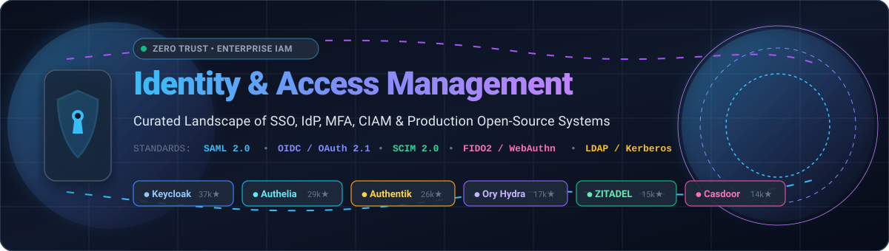
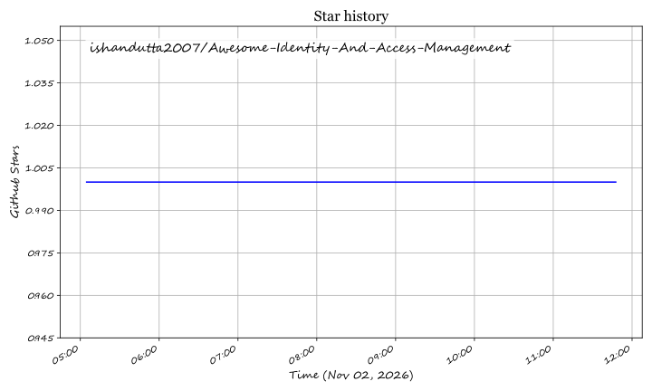

# 🔐 Awesome Identity and Access Management (IAM)

  
  
  
  
  
  

  A curated directory of leading <strong>Identity & Access Management (IAM)</strong> platforms, Enterprise Single Sign-On (<strong>SSO</strong>), Multi-Factor Authentication (<strong>MFA</strong>), Customer Identity (<strong>CIAM</strong>), Identity Governance (<strong>IGA</strong>), and production-grade open-source identity providers.

---

Identity and Access Management (IAM) forms the cornerstone of **Zero Trust architectures** and enterprise access governance. This guide indexes commercial enterprise identity platforms (SaaS/Hosted) alongside top open-source identity providers—comparing transparent starting tier pricing, free-tier limits, market scale, and protocol compatibility across **SAML 2.0**, **OpenID Connect (OIDC)**, **OAuth 2.1**, **SCIM 2.0**, **FIDO2 / WebAuthn Passkeys**, and **LDAP/RADIUS** federation.

---

## 📑 Table of Contents

- [📊 Sector Overview & Market Dynamics](#-sector-overview--market-dynamics)
- [☁️ SaaS / Hosted Enterprise Platforms](#️-saas--hosted-enterprise-platforms)
- [🔓 Open-Source GitHub Projects](#-open-source-github-projects)
- [🌟 Star History](#-star-history)
- [💖 Support & Community](#-support--community)
- [🤝 How to Contribute](#-how-to-contribute)
- [⚖️ Disclaimer](#️-disclaimer)

---

## 📊 Sector Overview & Market Dynamics

The global Identity and Access Management (IAM) market is estimated at **$23 billion to $27 billion in 2025–2026** and is projected to expand at a compound annual growth rate (CAGR) of **12%–14%**, reaching over **$50 billion by 2032**. The sector is **moderately concentrated** at the top tier—dominated by major enterprise tech giants and consolidated security suites (Microsoft Entra ID, Okta, Cisco Duo, Ping/ForgeRock) capturing the majority of global workforce directory spend—yet remains **fragmented across specialized niches** such as Customer Identity (CIAM), developer-first authentication APIs, Privileged Access Management (PAM), and machine/agentic identity orchestration where specialized and open-source innovators continue to gain strong adoption.

---

## ☁️ SaaS / Hosted Enterprise Platforms

| Product | Scale (Revenue / Valuation) | Pricing | Free Tier Limit | Description |
|---|---|---|---|---|
| **[Microsoft Entra ID](https://www.microsoft.com/en-us/security/business/microsoft-entra)** | ~$3.1T Market Cap / >$20B+ Security ARR | $6.00/user/month (Entra ID P1) / $9.00/user/month (Entra ID P2) | Free plan: up to 50,000 MAU for core directory, SSO to 10 apps/user, and basic MFA; 30-day trial for P1/P2 | 🏢 Enterprise cloud identity and access management service with Conditional Access, passwordless MFA, and deep Microsoft 365/Azure integration. |
| **[Duo Security (Cisco)](https://duo.com/)** | ~$230B Cisco Market Cap / ~$2.35B Acq. Valuation | $3.00/user/month (Duo MFA) / $6.00/user/month (Duo Access) | Free forever for up to 10 users (includes Duo MFA, mobile app, and basic security policies); 30-day trial on paid tiers | 🛡️ Zero-trust authentication and access security platform providing phishing-resistant MFA, endpoint device posture checks, and adaptive access policies. |
| **[Atlassian Access (Guard)](https://www.atlassian.com/software/access)** | ~$45B Market Cap / $4.4B ARR | $4.00/user/month (Guard Standard) | 30-day free trial with full organization security and SSO features | 🔑 SSO, SAML enforcement, SCIM provisioning, and centralized audit logging across Atlassian Cloud products (Jira, Confluence, Bitbucket). |
| **[Okta](https://www.okta.com/)** | ~$13B Market Cap / $2.6B ARR | $2.00/user/month (SSO) / $3.00/user/month (Adaptive MFA) | 30-day free trial with full enterprise workforce capabilities | 🌐 Leading independent enterprise identity platform with SSO, Adaptive MFA, Lifecycle Management, and universal directory across thousands of apps. |
| **[CyberArk](https://www.cyberark.com/)** | ~$13B Market Cap / $1.0B ARR | ~$4.00–$5.00/user/month (CyberArk Identity / Workforce Password Management) | 30-day free trial with full workforce identity security capabilities | 🔒 Identity security and Privileged Access Management (PAM) platform providing unified SSO, adaptive MFA, and lifecycle management for high-risk accounts. |
| **[Auth0](https://auth0.com/)** | $6.5B Acq. Valuation (Okta subsidiary) | $35.00/month (B2C Essentials, up to 1,000 MAU) / $130.00/month (B2B Essentials, up to 500 MAU) | Free forever for up to 7,500 monthly active users (MAU) with unlimited social logins and standard MFA | 💻 Developer-first customer & workforce identity platform offering extensible authentication APIs, universal login, and turnkey enterprise SSO connections. |
| **[Ping Identity](https://www.pingidentity.com/)** | $2.8B Acq. Valuation (Thoma Bravo) | $3.00/user/month (PingOne Workforce Essential, min 5,000 users) | 30-day free trial with up to 1,000 active identities and 5 sandbox environments | ⚡ Enterprise hybrid and cloud IAM platform offering SSO, adaptive MFA, intelligent fraud/risk protection, and decentralized identity. |
| **[ForgeRock](https://www.forgerock.com/)** | $2.3B Acq. Valuation (Thoma Bravo / merged with Ping) | ~$3.00/user/month (Workforce) / ~$35,000/year (PingOne/ForgeRock enterprise packages) | 30-day free trial through unified Ping Identity platform evaluation | 🤖 Comprehensive digital identity platform (merged with Ping Identity) delivering AI-driven access governance, identity orchestration, and autonomous identity. |
| **[JumpCloud](https://jumpcloud.com/)** | $2.6B Valuation | $9.00/user/month (SSO Package) / $11.00/user/month (Core Directory) | Free forever for up to 10 users and 10 devices (includes 10 days of premium support) | 🖥️ Open directory platform combining cloud LDAP, Cloud RADIUS, cross-OS device management (MDM), and workforce SSO. |
| **[OneLogin](https://www.onelogin.com/)** | ~$1.5B est. (Part of One Identity / Quest Software) | $2.00/user/month (Advanced Directory & SSO) | 30-day free trial (no credit card required) | 🎯 Comprehensive workforce IAM platform by One Identity featuring SSO, smart factor MFA, and automated user provisioning workflows. |

---

## 🔓 Open-Source GitHub Projects

Curated list of production-ready open-source Identity and Access Management platforms, sorted by GitHub stargazers count descending:

- **[Keycloak](https://github.com/keycloak/keycloak)**   
  👑 The most widely deployed open-source identity and access management server (Apache-2.0, CNCF incubating, backed by Red Hat). Delivers comprehensive **OIDC, OAuth 2.0, and SAML 2.0** support, LDAP/AD user federation, identity brokering, fine-grained authorization services, and **SCIM 2.0 server** capabilities.

- **[Authelia](https://github.com/authelia/authelia)**   
  🛡️ Lightweight open-source authentication and authorization server (Apache-2.0, Go) acting as an identity companion for reverse proxies (Nginx, Traefik, Caddy, Envoy). Provides multi-factor authentication (TOTP, WebAuthn/FIDO2, Duo push) and OpenID Connect (OIDC) provider capabilities for self-hosted apps.

- **[Authentik](https://github.com/goauthentik/authentik)**   
  🎨 An exceptionally flexible open-source identity provider (MIT core) with a visual stage-and-flow editor for custom login logic. Features an integrated forward-proxy provider to protect legacy apps without native authentication, alongside native OIDC, SAML, LDAP outpost, and RADIUS support.

- **[Ory Hydra](https://github.com/ory/hydra)**   
  🚀 Hardened, OpenID Certified OAuth 2.0 and OpenID Connect provider (Apache-2.0, Go) built for cloud-native architectures. Headless and API-first, allowing teams to fully control user interaction and login screens while delegating standard crypto/token security.

- **[ZITADEL](https://github.com/zitadel/zitadel)**   
  🏢 Cloud-native identity infrastructure built specifically for multi-tenant B2B SaaS (AGPL-3.0, Go). Features turnkey organizations, delegated administration, audit trails, and support for OIDC, OAuth 2.1, SAML, and Passkeys.

- **[SuperTokens](https://github.com/supertokens/supertokens-core)**   
  🧩 Open-source developer-friendly alternative to Auth0 and Firebase Auth (Apache-2.0 core). Offers modular authentication architecture with recipes for session management, social login, passwordless login, MFA, and enterprise SSO/SAML integration.

- **[Casdoor](https://github.com/casdoor/casdoor)**   
  🌐 Lightweight UI-first IAM platform built in Go and React (Apache-2.0) that offers the broadest protocol support in a single binary: OIDC, OAuth 2.0, SAML, CAS, LDAP server, RADIUS server, and SCIM. Includes built-in Casbin authorization and support for AI-agent OAuth 2.1/MCP.

- **[Ory Kratos](https://github.com/ory/kratos)**   
  🧱 Cloud-native, API-first identity and user management system (Apache-2.0, Go). Implements core authentication, MFA/WebAuthn, registration, profile updates, account recovery, and verification workflows with clean headless APIs.

- **[Apereo CAS](https://github.com/apereo/cas)**   
  🏛️ Enterprise multilingual Single Sign-On engine for web applications (Apache-2.0, Java). Supports Central Authentication Service (CAS) protocol, SAML 2.0, OAuth 2.0, OpenID Connect, multifactor authentication, and integration with varied directory stores.

- **[Dex IdP](https://github.com/dexidp/dex)**   
  🔗 Identity service and federation broker using OpenID Connect (Apache-2.0, CNCF Sandbox, Go). Acts as a portal to other identity providers through connectors (SAML, LDAP, GitHub, Google, GitLab, Keystone) to provide OIDC authentication to downstream apps like Kubernetes.

- **[Kanidm](https://github.com/kanidm/kanidm)**   
  🦀 Fast, modern identity management and directory service written in Rust (MPL-2.0). Serves as an alternative to OpenLDAP, 389ds, and FreeIPA with native support for OAuth 2.0, OIDC, RADIUS, and passwordless authentication via WebAuthn/Passkeys.

- **[FreeIPA](https://github.com/freeipa/freeipa)**   
  🐧 Integrated security information management solution (GPL-3.0) combining 389 Directory Server (LDAP), MIT Kerberos, Dogtag Certificate System (PKI), NTP, and DNS. Provides centralized Linux/Unix identity, policy, and trust management.

- **[WSO2 Identity Server](https://github.com/wso2/product-is)**   
  ⚙️ Enterprise-grade, API-driven IAM software (Apache-2.0, Java) providing single sign-on, identity federation, adaptive MFA, customer identity management (CIAM), and identity governance compliant with GDPR and open standards.

- **[Evolveum midPoint](https://github.com/Evolveum/midpoint)**   
  📜 The leading comprehensive open-source Identity Governance and Administration (IGA) platform (EUPL-1.2/Apache-2.0). Excels at user provisioning, automated lifecycle management, role catalog management, access requests, and compliance auditing.

- **[Apache Syncope](https://github.com/apache/syncope)**   
  🗄️ Open-source digital identity management system (Apache-2.0, Java) managing user, role, and organization data with automated provisioning, access certification, delegated administration, and SCIM 2.0 / SAML 2.0 / OIDC interfaces.

---

## 🌟 Star History

---

## 💖 Support & Community

Thank you so much for visiting and using this resource! If you find this directory valuable for your identity architecture, security reviews, or homelab setup, please consider supporting the project:

- ⭐ **Star this repository** to help others discover it across GitHub.
- 🍴 **Fork and contribute** by adding emerging IAM tools, corrections, or open-source solutions.
- 📢 **Share with your colleagues** on LinkedIn, X/Twitter, Discord, or Reddit.
- ☕ **Buy a coffee / sponsor ongoing maintenance**: Support development directly via the [GitHub Sponsor Dashboard](https://github.com/sponsors/ishandutta2007).

Your support keeps this directory accurate, up-to-date, and free for the global engineering community! 🙌

---

## 🤝 How to Contribute

1. 🍴 Fork the repository.
2. 📝 Add or edit entries in `README.md` (maintain existing table / list formats).
3. 🔗 Include: name, link, concise 1–2 sentence description, scale/pricing, and proper category (SaaS or open-source).
4. 🚀 Submit a PR with a short explanation.

---

## ⚖️ Disclaimer

- 📌 This is a **community-curated** list — not exhaustive and not an official commercial endorsement.
- 🔐 IAM platforms handling authentication credentials and identity data must comply with applicable security standards (SOC 2, ISO 27001) and privacy regulations; **self-hosted IdPs become critical infrastructure**—an outage or misconfiguration can lock users out of all connected applications.
- 💡 **Open-source IAM is exceptionally mature**—Keycloak provides enterprise-grade SSO and federation, Casdoor provides the broadest protocol coverage in a single binary, and Authentik/ZITADEL serve specialized needs. However, **commercial platforms differentiate on managed compliance, customer identity at scale, and AI-driven access decisions**—Okta Customer Identity and Ping's AI-powered risk protection remain commercial advantages. Choose based on whether you need maximum community/audit recognition (Keycloak), protocol breadth (Casdoor), visual flows (Authentik), or B2B multi-tenancy (ZITADEL).
- 📄 Verify license terms for commercial use; Keycloak and Casdoor use Apache-2.0, ZITADEL uses AGPL-3.0, and Authentik uses MIT for core with commercial enterprise features.

---

  <strong>Made for identity architects, IT administrators, and security engineers choosing their IAM platform.</strong> 
  Let's make identity and access management more transparent, secure, and accessible! 🚀

## Star History

<a href="https://star-history.com/#ishandutta2007/Awesome-Identity-And-Access-Management&Timeline" align="center">
  <picture>
    <source media="(prefers-color-scheme: dark)" srcset="assets/ishandutta2007_Awesome-Identity-And-Access-Management_growth.svg">
    
  </picture>
</a>
